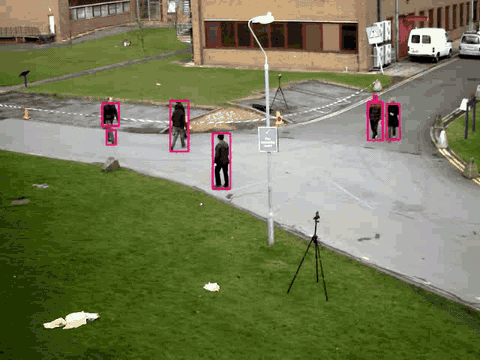

# Moving Object Detection

Real-time motion detection with Python and OpenCV. The script compares each video frame against a background model, isolates the regions that changed, and draws bounding boxes around moving objects. It works with a live webcam or any video file, and can save the annotated result.



## Features

- Webcam or video file input
- Three background models: first frame, running average, and OpenCV's MOG2
- Tunable sensitivity (difference threshold and minimum object size)
- Optional annotated video export (`.mp4`)
- Headless mode for servers or batch processing
- Only two dependencies: OpenCV and NumPy

## Quick start

```bash
git clone https://github.com/jinxbuilds/MovingObjectDetection-main.git
cd MovingObjectDetection-main
pip install -r requirements.txt

python motion_detector.py              # default webcam, press q to quit
```

## Usage

```bash
# Process a video file
python motion_detector.py --source path/to/video.mp4

# Use the MOG2 model and save the annotated output
python motion_detector.py --source video.mp4 --method mog2 --output result.mp4

# Less sensitive: ignore small objects and minor changes
python motion_detector.py --min-area 1500 --threshold 40

# Run without a preview window
python motion_detector.py --source video.mp4 --output result.mp4 --no-display
```

| Option | Default | Description |
|---|---|---|
| `--source` | `0` | Camera index or path to a video file |
| `--method` | `running-avg` | Background model: `first-frame`, `running-avg` or `mog2` |
| `--min-area` | `500` | Minimum contour area (px²) to count as motion |
| `--threshold` | `25` | Pixel difference (0–255) treated as a change |
| `--width` | `600` | Frames are resized to this width before processing |
| `--output` | none | Save the annotated video to this path |
| `--no-display` | off | Don't open a preview window |

## How it works

1. **Pre-process.** Each frame is resized, converted to grayscale and smoothed with a Gaussian blur to suppress sensor noise.
2. **Background model.**
   - `first-frame`: the first frame is the background. Simple, but sensitive to lighting changes.
   - `running-avg`: the background is a weighted running average that slowly adapts to gradual changes such as light shifts.
   - `mog2`: OpenCV's Gaussian-mixture background subtractor, the most robust option for busy scenes.
3. **Difference and threshold.** The absolute difference between the frame and the background is thresholded into a binary mask, then dilated to fill gaps.
4. **Contours.** External contours are extracted from the mask; contours smaller than `--min-area` are discarded as noise.
5. **Annotate.** A bounding box is drawn around each remaining contour, and a status label shows whether motion is present.

## Using it in your own code

```python
import cv2
from motion_detector import MotionDetector, Config

detector = MotionDetector(Config(method="mog2", min_area=800))
cap = cv2.VideoCapture("video.mp4")
while True:
    ok, frame = cap.read()
    if not ok:
        break
    for x, y, w, h in detector.detect(frame):
        print("motion at", x, y, w, h)
```

## Applications

Video surveillance, intrusion alerts, traffic and road monitoring, wildlife cameras, and as a cheap first stage before running a heavier object-detection model only on frames that contain motion.

## Possible improvements

- Object tracking across frames (e.g. centroid or SORT tracking)
- Classifying detected objects with a pretrained model such as YOLO
- Alerts (email or webhook) when motion is detected

## License

[MIT](LICENSE)
